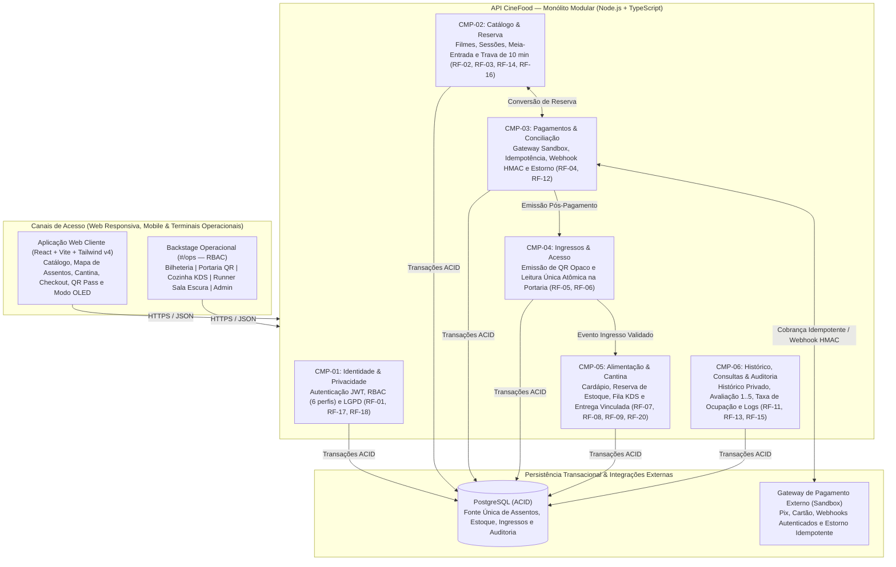

# CineFood 🍿🎬

> **Plataforma Digital Integrada de Autoatendimento de Bilheteria, Validação Atômica de Acesso por QR Code e Delivery de Bomboniere na Poltrona para Cinemas.**

[-cinefood.vercel.app-000000?style=flat-square&logo=vercel)](https://cinefood.vercel.app)
[](./docs/releases/v1.0.0-release-notes.md)
[](./docs/Manual_de_Processos_CineFood_v2.1.pdf)
[-10B981?style=flat-square)](./docs/Manual_de_Processos_CineFood_v2.1.pdf)
[](./docs/testes/auditoria-wcag-usabilidade.md)
[-6366F1?style=flat-square)](./openspec/config.yaml)

🌐 **Acesse a Aplicação Publicada na Vercel:** [**https://cinefood.vercel.app**](https://cinefood.vercel.app) *(Espectador: `/` \| Backstage Operacional RBAC: [`https://cinefood.vercel.app/#/ops`](https://cinefood.vercel.app/#/ops))*

---

## 🏛️ Identificação Institucional e Acadêmica

Este repositório abriga os artefatos de engenharia de software, especificações formais, suítes de verificação automatizada, monólito modular back-end e aplicação web responsiva do projeto **CineFood**, desenvolvido pela equipe **Cavaleiros da Tela Azul** no âmbito do curso de **Engenharia de Software** do **Instituto de Informática da Universidade Federal de Goiás (INF/UFG)**.

| Atributo | Especificação |
| :--- | :--- |
| **Instituição** | Universidade Federal de Goiás (UFG) — Instituto de Informática (INF) |
| **Curso / Disciplina** | Engenharia de Software — *Processos de Engenharia de Software* |
| **Docente Orientadora** | Prof.ª Dra. Juliana Souza-Zinader |
| **Equipe Fornecedora** | **Cavaleiros da Tela Azul** |
| **Organização Contratante (Cenário Piloto)** | *CineFood Operações Piloto Ltda.* (Unidade piloto com 4 salas de exibição e cantina própria) |
| **Referenciais Normativos** | ABNT NBR ISO/IEC/IEEE 12207:2021, ISO/IEC/IEEE 12207:2017 e Guia Geral MPS.BR 2024 (Softex) |
| **Versão do Produto / Manual** | Produto `v1.0.0` (MVP) \| Manual de Processos `v2.4` (Consolidada) |

### 👥 Equipe Responsável e Matriz de Papéis

As atividades técnicas e gerenciais são distribuídas entre quatro papéis funcionais com responsabilidade única por entrega e revisão cruzada obrigatória por par independente (*peer review*):

| Papel | Integrante | Função Principal e Escopo de Atuação |
| :--- | :--- | :--- |
| **RP — Responsável de Produto** | **Gabriel Alves Martins** | *Engenheiro de Requisitos e Produto.* Gestão de escopo e backlog, priorização MoSCoW, Estrutura Analítica do Projeto (EAP), controle semanal de prazos/issues, condução do aceite funcional e conformidade negocial (CDC, Meia-Entrada e LGPD). |
| **RT — Responsável Técnico** | **Paulo Cesar Martins dos Santos** | *Arquiteto de Software e Engenheiro Back-end.* Definição da arquitetura em monólito modular (`CMP-01` a `CMP-06`), modelagem relacional e transações ACID no PostgreSQL, contratos REST/OpenAPI, segurança, integração idempotente de pagamentos/webhooks e mitigação de riscos técnicos. |
| **RI — Responsável de Interfaces** | **Matheus Silva Moreira** | *Engenheiro Front-end e UX/UI.* Projeto e implementação da aplicação web responsiva (React + TypeScript) e prototipação mobile (Android), identidade visual *Dark-First* com modo **Sala Escura OLED (`#000000`)**, experiência dos painéis operacionais e conformidade WCAG 2.2 Nível AA. |
| **RQ — Responsável de Qualidade** | **Felipe Gabriel Souza Fernandes** | *Engenheiro de Qualidade (QA) e Configuração.* Garantia da qualidade do processo e do produto, automação de testes unitários, de integração e E2E, gestão de configuração e releases, pipeline de CI/CD, matriz de rastreabilidade (`spec-guard`) e avaliação de melhoria com MPS.BR. |

---

## 🎯 Visão Geral do Produto e Problema Atendido

### O Problema Operacional
Em cinemas de pequeno e médio porte, o espectador enfrenta filas presenciais duplicadas — uma na bilheteria para adquirir ingressos e outra na bomboniere para solicitar alimentos —, além de sistemas isolados que não compartilham mapa de assentos nem saldo de estoque em tempo real. Sem vínculo sistêmico entre o ingresso validado fisicamente na portaria e o pedido da cantina, torna-se inviável autorizar com segurança a entrega de alimentos na poltrona, aumentando o risco de *overbooking* de assentos em horários de pico, ruptura de estoque após o pagamento e despacho prematuro de pedidos para espectadores que ainda não ingressaram na sala.

### A Solução CineFood
O **CineFood** unifica a jornada de consulta de programação, reserva exclusiva de poltronas numeradas, compra de ingressos (inteira e meia-entrada legal), validação atômica de acesso por QR Code e pedidos de bomboniere (para retirada no balcão ou entrega direta no assento) sob uma **API única em monólito modular** e uma **interface web responsiva *Dark-First*** equipada com modo **Sala Escura OLED (`#000000`)** para uso confortável dentro da sala de exibição.

### Objetivos Específicos Verificáveis
1. **Controle Transacional Unificado (`ADR-002`, `ADR-004`):** Garantir reserva exclusiva e temporária de assentos (trava regressiva de **10 minutos**) e controle único de estoque entre canais digitais (Web/Android) e venda assistida presencial na bilheteria.
2. **Pagamento Seguro, Idempotente e Conciliado (`ADR-003`):** Processar pagamentos eletrônicos (Pix e Cartão em modo *Sandbox*) com chaves de idempotência (`Idempotency-Key`), validação criptográfica de webhooks (`HMAC-SHA256`) e **estorno automático de "Pix Tardio"** caso a confirmação ocorra após a expiração da reserva e perda do assento (`RN-01`).
3. **Entrega no Assento Vinculada ao Acesso (`RST-04`, `RN-03`):** Condicionar o preparo e a saída de pedidos na modalidade `ENTREGA_ASSENTO` à confirmação prévia e atômica da leitura única do QR Code do titular na portaria, com conversão para retirada no balcão caso o cliente não seja localizado na poltrona após 2 minutos (`RF-20`).
4. **Gestão Operacional, Transparência e Privacidade (`RF-01`..`RF-18`):** Disponibilizar painéis dedicados por perfil operacional (**Bilheteria**, **Portaria QR**, **Cozinha/KDS**, **Runner de Sala Escura** e **Administração**), cancelamento alinhado ao art. 49 do CDC e atendimento aos direitos do titular sob a LGPD.

---

## 🏛️ Arquitetura do Sistema e Decisões Técnicas (ADRs)

O sistema adota a arquitetura de **Monólito Modular Orientado a Contratos (*Spec-Anchored*)** (`ADR-001`), na qual a aplicação Web em React (`web/`) e os terminais operacionais consomem contratos explícitos providos pelos módulos de domínio em TypeScript (`src/modules/`), tendo o banco relacional PostgreSQL como única autoridade transacional (`ADR-002`).



### Componentes Arquiteturais Internos (`CMP-01` a `CMP-06`)

| Código | Componente | Diretório no Repositório | Responsabilidades e Requisitos Atendidos |
| :--- | :--- | :--- | :--- |
| **`CMP-01`** | **Identidade e Privacidade** | [`src/modules/identity/`](./src/modules/identity/) e [`src/modules/privacy/`](./src/modules/privacy/) | Cadastro, autenticação, autorização server-side por papel (`RBAC`), aviso de privacidade versionado, consentimento granular de marketing e protocolo de direitos do titular LGPD (`RF-01`, `RF-17`, `RF-18`). |
| **`CMP-02`** | **Catálogo e Reserva de Assentos** | [`src/modules/catalog/`](./src/modules/catalog/) e [`src/modules/booking/`](./src/modules/booking/) | Catálogo de filmes (integração TMDB/OMDb e selos indicativos oficiais), sessões ativas, mapa de 96 poltronas (incluindo PCD e Obeso 1.5×), bloqueio atômico de 10 minutos, venda assistida e cálculo server-side de meia-entrada (`RF-02`, `RF-03`, `RF-14`, `RF-16`). |
| **`CMP-03`** | **Pagamentos e Conciliação** | [`src/modules/payments/`](./src/modules/payments/) | Adaptador de gateway em modo *Sandbox*, chaves únicas de idempotência, verificação criptográfica de webhooks, conciliação de timeouts e estorno automático por conflito de expiração ou CDC (`RF-04`, `RF-12`). |
| **`CMP-04`** | **Ingressos e Controle de Acesso** | [`src/modules/tickets/`](./src/modules/tickets/) | Emissão de 1 ingresso digital com token QR Code opaco assinado por assento confirmado, leitura e consumo atômico único na portaria (`EMITIDO -> UTILIZADO`) e invalidação em caso de estorno (`RF-05`, `RF-06`, `RF-12`). |
| **`CMP-05`** | **Alimentação e Cantina** | [`src/modules/canteen/`](./src/modules/canteen/) | Cardápio de combos e adicionais, recálculo estrito de preços em centavos no servidor, reserva condicional de estoque sem saldo negativo, máquina de estados do KDS, trava de entrega vinculada à portaria e fallback do Runner para balcão (`RF-07`, `RF-08`, `RF-09`, `RF-20`). |
| **`CMP-06`** | **Histórico, Consultas e Operação** | [`src/modules/history/`](./src/modules/history/), [`src/modules/management/`](./src/modules/management/) e [`src/modules/operations/`](./src/modules/operations/) | Histórico consolidado do titular, avisos internos, avaliação privada pós-sessão (1 a 5 estrelas), administração de catálogo/preços, cálculo de taxa de ocupação, cancelamento CDC e prontidão operacional (`RF-10`, `RF-11`, `RF-12`, `RF-13`, `RF-15`). |

### Decisões Arquiteturais Fundamentais (`ADR-001` a `ADR-005`)

- **`ADR-001` — Arquitetura em Monólito Modular:** Unifica os seis componentes de negócio em uma mesma unidade de implantação TypeScript, maximizando simplicidade operacional, tipagem ponta a ponta e transações ACID diretas (pontuação ponderada `4,35 / 5,00` frente a serverless e microsserviços).
- **`ADR-002` — Controle Transacional Condicional de Assentos no Banco:** Rejeita travas voláteis apenas em tela; toda reserva aplica atualização condicional atômica (`estado = 'DISPONIVEL' OR (estado = 'RESERVADO' AND reservado_ate <= NOW())`) com expiração parametrizável (padrão de 10 minutos).
- **`ADR-003` — Pagamento Assíncrono com Idempotência e Webhook Autenticado:** Chamadas externas ao provedor ocorrem fora da transação de banco; compras só são confirmadas mediante webhook assinado válido, disparando compensação e estorno automático se a reserva já tiver expirado e o lugar estiver ocupado por terceiro (`RN-01`).
- **`ADR-004` — Fonte Transacional Única entre Canais Digitais e Presenciais:** Web, Android e terminais de Bilheteria, Portaria e Cantina operam sobre os mesmos contratos e estado central em tempo real, eliminando divergências de disponibilidade (`RST-02`).
- **`ADR-005` — Checkouts Independentes entre Ingresso e Alimentação:** Separa as transações financeiras de bilheteria e bomboniere (`RN-04`), permitindo comprar apenas ingresso, pedir alimentos durante a sessão ou adquirir itens exclusivamente para retirada no balcão sem exigir ingresso.

---

## 📋 Requisitos, Restrições e Marcos do Ciclo de Vida

O ciclo de vida segue o modelo **iterativo e incremental** em ciclos quinzenais ao longo de 24 semanas (`S1` a `S24`, orçamento planejado de `960 h`), estruturado em 6 marcos (`MAR-01` a `MAR-06`):

| Marco | Período (EAP) | Pacote de Trabalho | Entregas e Requisitos Principais | Tag de Versão |
| :--- | :---: | :--- | :--- | :---: |
| **`MAR-01`** | `S1–S6` (`192 h`) | **1.1 Fundamentos** | Protótipo UI/UX *Dark-First* WCAG 2.2 AA, CI, Identidade/RBAC (`RF-01`), Catálogo e Mapa de Assentos (`RF-02`) e Transparência LGPD (`RF-17`). | `v0.1.0` |
| **`MAR-02`** | `S7–S10` (`128 h`) | **1.2 Ingressos** | Reserva concorrente com trava de 10 min (`RF-03`), Pagamento Sandbox idempotente e estorno de Pix tardio (`RF-04`), Venda Assistida (`RF-14`) e Meia-Entrada legal (`RF-16`). | `v0.2.0` |
| **`MAR-03`** | `S11–S13` (`96 h`) | **1.3 Acesso e Histórico** | Emissão de ingresso com QR Code opaco (`RF-05`), Validação atômica de leitura única na portaria (`RF-06`), Histórico privado (`RF-11`) e Avaliação pós-sessão (`RF-13`). | `v0.3.0` |
| **`MAR-04`** | `S14–S18` (`160 h`) | **1.4 Alimentação e Gestão** | Cardápio e recálculo server-side (`RF-07`), Reserva de estoque (`RF-08`), Fluxo KDS e entrega vinculada no assento (`RF-09`, `RF-20`), Admin (`RF-10`), Estorno CDC (`RF-12`), Ocupação (`RF-15`) e Direitos LGPD (`RF-18`). | `v0.4.0` |
| **`MAR-05`** | `S19–S22` (`128 h`) | **1.5 Verificação Integrada** | Regressão completa, bateria de carga e integridade (`RNF-01` `p95 <= 2s`, `RNF-02`, `RNF-03`), auditoria WCAG 2.2 AA e usabilidade (`RNF-04`) e cobertura `>= 70%` (`RNF-06`). | `v1.0.0-rc.1` |
| **`MAR-06`** | `S23–S24` (`64 h`) | **1.6 Encerramento e Transição** | Smoke test ponta a ponta em modo Sandbox (`RST-01`, `RST-03`), ensaio de backup e restauração PostgreSQL/WAL (`RNF-05`), matriz de rastreabilidade final e release oficial. | `v1.0.0` |

> 📄 A rastreabilidade individualizada completa entre necessidades (`N1`–`N6`), requisitos (`RF-01`–`RF-18`, `RF-20`, `RNF-01`–`RNF-06`), restrições (`RST-01`–`RST-04`), componentes (`CMP-01`–`CMP-06`), especificações OpenSpec e suítes de teste está documentada em [`docs/releases/matriz-rastreabilidade-v1.0.0.md`](./docs/releases/matriz-rastreabilidade-v1.0.0.md).

---

## 🔗 Engenharia Orientada a Especificação (Cadeia do Contrato & OpenSpec)

Neste repositório, **a especificação é a única fonte da verdade (SSOT)**. Nenhuma alteração comportamental em `src/` é admitida sem vínculo explícito com sua especificação em `openspec/` e com o teste automatizado que a comprova:

```text
[01 CONSTITUTION] ──► [02 PRODUCT] ──► [03 FEATURE SPEC] ──► [04 COMPONENT] ──► [05 TASKS] ──► [06 TESTS]
       │                                       ▲
       └─────────────────► [ADRs] ─────────────┘
```

1. **Regra Obrigatória do `@test:`:** Em todo arquivo `spec.md` dentro de `openspec/changes/<marco>/specs/`, cada Critério de Aceite (`AC-n`) deve apontar para o arquivo físico de teste que o verifica:
   ```markdown
   - **AC-1.** Na disputa concorrente entre canais pelo mesmo assento, apenas uma reserva ativa é criada e a expiração de 10 min libera o lugar.
     @test:tests/booking/reserva.test.ts
   ```
2. **Guardião Mecânico de Contrato (`scripts/spec-guard.py`):** Executado via `npm run check:spec` e no hook `.githooks/pre-commit`, valida mecanicamente que:
   - Toda AC possui uma anotação `@test:<caminho>` válida;
   - Todos os arquivos de teste referenciados existem fisicamente no repositório;
   - Nenhum código em `src/` é comitado sem atualização correspondente na especificação em `openspec/`.

---

## 📂 Estrutura do Repositório

```text
cinefood/
├── docs/                                  # Documentação normativa, diagramas UML, testes e releases
│   ├── Manual_de_Processos_CineFood_v2.1.pdf
│   ├── diagramas/                         # Diagramas interativos HTML/Archify (Classes, Atividades e Sequência)
│   ├── operacao/                          # Checklist de prontidão piloto e plano de contingência/rollback
│   ├── prototipo/                         # Protótipo inicial de referência
│   ├── releases/                          # Matriz de rastreabilidade v1.0.0 e Release Notes oficiais
│   └── testes/                            # Auditoria WCAG 2.2 AA e ensaio de backup/restauração (RPO/RTO)
├── openspec/                              # Especificações SDD por marco (MAR-01 a MAR-06) e deltas de UX
│   └── changes/
│       ├── mar-01-fundamentos/
│       ├── mar-02-ingressos-reserva/
│       ├── mar-03-acesso-historico/
│       ├── mar-04-cantina-gestao/
│       ├── mar-05-qualidade-rnf/
│       └── mar-06-transicao-operacao/
├── scripts/
│   ├── spec-guard.py                      # Verificador mecânico da Cadeia do Contrato (ACs <-> @test)
│   └── verify-backup-restore.mjs          # Simulador de snapshot SHA-256 e replay idempotente de WAL (RNF-05)
├── src/                                   # Monólito Modular Back-end em TypeScript (CMP-01 a CMP-06)
│   ├── design-tokens.json                 # Tokens de design e contraste WCAG 2.2 AA
│   └── modules/
│       ├── identity/                      # CMP-01: Autenticação e autorização RBAC
│       ├── privacy/                       # CMP-01: Aviso de privacidade, opt-in e direitos LGPD
│       ├── catalog/                       # CMP-02: Filmes, salas, sessões e mapa de assentos
│       ├── booking/                       # CMP-02: Reserva concorrente (trava 10 min), meia-entrada e bilheteria
│       ├── payments/                      # CMP-03: Gateway sandbox, idempotência, webhooks e estornos
│       ├── tickets/                       # CMP-04: Emissão de QR Code opaco e validação atômica única
│       ├── canteen/                       # CMP-05: Cardápio, estoque, KDS, entrega no assento e Runner
│       ├── history/                       # CMP-06: Histórico do titular e avaliação pós-sessão (1..5)
│       ├── management/                    # CMP-06: Administração de sessões, ocupação e cancelamento CDC
│       └── operations/                    # MAR-06: Smoke test piloto, trava sandbox (RST-03) e conciliação
├── tests/                                 # Suítes de testes unitários, de integração e RNFs (Node Test Runner)
│   ├── identity/
│   ├── privacy/
│   ├── catalog/
│   ├── booking/
│   ├── payments/
│   ├── tickets/
│   ├── canteen/
│   ├── history/
│   ├── management/
│   ├── quality/
│   └── operations/
└── web/                                   # Aplicação Web Responsiva (React 19 + Vite + TypeScript + Tailwind v4)
    ├── public/assets/                     # Pôsteres, backdrops, fotos da cantina e selos de classificação gov.br
    ├── src/
    │   ├── components/                    # Jornadas do Espectador e Backstage Operacional (#/ops)
    │   ├── data/                          # Dados demonstrativos de salas, sessões, assentos e cardápio
    │   ├── services/                      # Integração de catálogo externo (TMDB / OMDb com fallback local)
    │   └── styles/                        # Design tokens CSS e tema Sala Escura OLED (#000000)
    └── tests/                             # Testes E2E e auditoria de acessibilidade com Playwright
```

---

## 🚀 Guia de Instalação, Execução e Verificação (≤ 30 min — `RNF-06`)

### Pré-requisitos
- **Node.js** `>= 22.x` (com suporte nativo a execução de TypeScript e `node:test`)
- **npm** `>= 10.x`
- **Python** `>= 3.10` (para execução do verificador de contrato `scripts/spec-guard.py`)

### 1. Clonar o Repositório e Instalar Dependências

```bash
git clone https://github.com/Cavaleiros-da-Tela-Azul/cinefood.git
cd cinefood

# Instala dependências da raiz (monólito modular e suíte de testes)
npm install

# Instala dependências da aplicação Web (React + Vite)
npm --prefix web install

# (Opcional) Ativa o hook mecânico de pré-commit do Git
git config core.hooksPath .githooks
```

### 2. Executar as Suítes de Verificação e Qualidade do Contrato

```bash
# 1. Executa todas as 16 suítes de testes automatizados dos módulos de negócio (MAR-01 a MAR-06)
npm test

# 2. Executa os testes com relatório de cobertura de linhas (meta RNF-06 >= 70%; atual > 90%)
npm run test:coverage

# 3. Executa o guardião mecânico da Cadeia do Contrato (OpenSpec <-> @test)
npm run check:spec

# 4. Executa o ensaio automatizado de Backup/Restore e replay de WAL (RNF-05 / RPO = 0)
node scripts/verify-backup-restore.mjs
```

### 3. Executar a Aplicação Web Localmente (`web/`)

```bash
# Inicia o servidor de desenvolvimento Vite em http://localhost:5173
npm --prefix web run dev

# Gera o bundle otimizado de produção em web/dist/
npm --prefix web run build

# Visualiza o build de produção localmente em http://localhost:4173
npm --prefix web run preview
```

#### Navegação na Aplicação Web
- **Jornada do Espectador (`/`):** Catálogo em destaque com busca e filtros por data/formato (`IMAX 3D`, `Dolby Atmos`, `2D`), detalhes editoriais e trailer, mapa interativo de assentos com cronômetro regressivo de 10 minutos e categorias de meia-entrada (Lei nº 12.933/2013), cardápio da bomboniere (`Retirada no Balcão` ou `Entrega na Poltrona`), checkout Sandbox (`Pix` / `Cartão`), ingresso digital com QR Code opaco, histórico de pedidos, cancelamento CDC, avaliações da comunidade e alternância instantânea para o modo **Sala Escura OLED (`#000000`)**.
- **Backstage Operacional (`#/ops` ou botão "Operação / Staff" no topo):** Ambiente autenticado com isolamento RBAC para simulação interativa dos perfis **Atendente de Bilheteria** (venda assistida), **Portaria QR** (leitura única atômica e liberação da cozinha), **Cozinha / KDS** (preparo de pedidos), **Runner de Sala Escura** (entrega na poltrona ou conversão para balcão após 2 min) e **Administrador do Cinema** (taxa de ocupação, vendas e estornos).

---

## 📊 Diagramas UML e Documentação Complementar

Os diagramas arquiteturais e modelos UML oficiais (construídos e validados geometricamente com **Archify**) podem ser abertos diretamente no navegador de forma *standalone*:

- 📐 [**Diagrama de Classes UML (`docs/diagramas/diagrama-classes.html`)**](./docs/diagramas/diagrama-classes.html) — Modelo estrutural completo em 4 camadas e 12 classes/enums de domínio.
- 🔄 [**Diagrama de Atividades UML (`docs/diagramas/diagrama-atividades.html`)**](./docs/diagramas/diagrama-atividades.html) — Fluxo comportamental ponta a ponta em 5 raias (*swimlanes*) e 6 nós de decisão.
- ⏱️ [**Diagrama de Sequência UML (`docs/diagramas/diagrama-sequencial.html`)**](./docs/diagramas/diagrama-sequencial.html) — Interação temporal em 4 segmentos e 20 mensagens REST/transacionais.
- 📘 [**Guia dos Diagramas (`docs/diagramas/README.md`)**](./docs/diagramas/README.md) — Explicação detalhada da modelagem e instruções de recompilação.
- 📑 [**Matriz de Rastreabilidade `v1.0.0` (`docs/releases/matriz-rastreabilidade-v1.0.0.md`)**](./docs/releases/matriz-rastreabilidade-v1.0.0.md)
- 🚀 [**Release Notes Oficiais `v1.0.0` (`docs/releases/v1.0.0-release-notes.md`)**](./docs/releases/v1.0.0-release-notes.md)
- ♿ [**Relatório de Auditoria WCAG 2.2 AA e Usabilidade (`docs/testes/auditoria-wcag-usabilidade.md`)**](./docs/testes/auditoria-wcag-usabilidade.md)
- 💾 [**Ensaio de Backup, Restauração e RPO/RTO (`docs/testes/ensaio-backup-rpo-rto.md`)**](./docs/testes/ensaio-backup-rpo-rto.md)
- 🛡️ [**Checklist de Prontidão Piloto (`docs/operacao/checklist-prontidao-piloto.md`)**](./docs/operacao/checklist-prontidao-piloto.md) e [**Plano de Contingência e Rollback (`docs/operacao/plano-contingencia-rollback.md`)**](./docs/operacao/plano-contingencia-rollback.md)

---

## ⚖️ Conformidade Legal e Restrições Operacionais

- **Ambiente de Demonstração Simulada (`RST-03`):** Enquanto a unidade piloto e o gateway comercial não estiverem formalmente contratados e homologados para operação com público real, o sistema opera estritamente em **modo Sandbox** com dados demonstrativos, bloqueando qualquer cobrança financeira real.
- **Código de Defesa do Consumidor (Lei nº 8.078/1990 — art. 49):** Direito de arrependimento e estorno integral em até 7 dias da compra, respeitando a janela operacional antes do início da sessão (`RF-12`).
- **Lei da Meia-Entrada (Lei nº 12.933/2013 e Decreto nº 8.537/2015):** Cálculo server-side de benefícios legais para estudantes, idosos, PCD e jovens de baixa renda mediante indicação de documento comprobatório (`RF-16`).
- **Lei Geral de Proteção de Dados Pessoais (Lei nº 13.709/2018 — LGPD):** Transparência prévia, separação de consentimento promocional opcional (`RF-17`), não armazenamento de dados completos de cartão (`PAN/CVV`) e atendimento a solicitações de acesso, retificação e eliminação com retenção legal auditada (`RF-18`).

---

<div align="center">
  <sub>Desenvolvido com rigor de Engenharia de Software pela <strong>Equipe Cavaleiros da Tela Azul</strong> — Instituto de Informática (INF/UFG) • 2026</sub>
</div>
